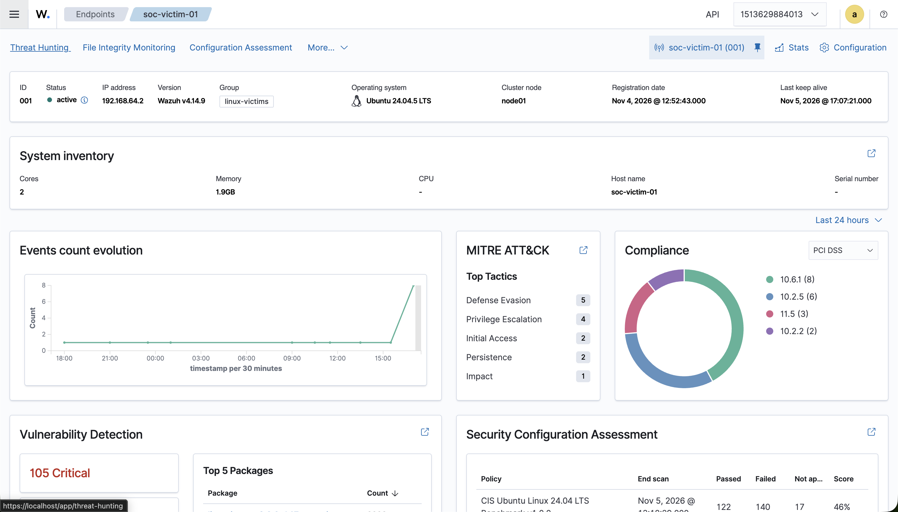

# Home SOC Lab

A self-built Security Operations Centre (SOC) lab running on a single laptop. I use it to practise the full blue-team loop: **collect logs → simulate attacks → detect → triage → report**.

> Status: ✅ Phases 1–2 complete: SIEM deployed, and all five attack scenarios detected live. Next: Phase 3, incident reports. See the [roadmap](docs/roadmap.md).

## Why this project

I'm a cybersecurity graduate focusing on security operations and governance, risk and compliance (GRC). This lab is where I build and show hands-on skills: deploying a SIEM, writing detection rules, mapping attacks to MITRE ATT&CK, and writing incident reports the way a SOC analyst would.

It also asks a practical question: **what should a small business (like a cafe) actually monitor, and what would it cost?**

## Dashboard



## Phase 1 highlights

- **Hardened the official Wazuh setup.** It ships with hard-coded default passwords, demo users with public passwords, and services on every network interface. Fixed all three and verified: defaults now return HTTP 401 ([ADR 0002](docs/adr/0002-run-wazuh-natively-in-docker.md)).
- **Closed a rogue-agent gap.** Agent enrolment was open to any device on the network. It now needs a password, and an attempt without one is rejected.
- **Found and fixed duplicate alerts.** Every login and sudo event arrived twice (from `/var/log/auth.log` and from journald), which would have inflated brute-force counts. Now each event is ingested from journald only, and verified as one alert per event.
- **File integrity with who-data.** Changes to `/etc`, sudoers and cron are attributed to the user who made them. `/etc/shadow` changes alert without sending password hashes to the SIEM.
- **CIS benchmark out of the box.** The first scan of the Ubuntu VM scored 46% on the CIS Ubuntu 24.04 benchmark, a baseline to harden later.

## Lab architecture

```
┌──────────────────────── MacBook (Apple Silicon, 16 GB) ────────────────────────┐
│                                                                                 │
│   Docker Desktop                                 Victim endpoints               │
│   ┌──────────────────────────────┐              ┌──────────────────────────┐    │
│   │ Wazuh single-node            │  agent logs  │ Ubuntu Linux (VM)        │    │
│   │  • Wazuh manager             │◄─────────────│  • Wazuh agent           │    │
│   │  • Wazuh indexer             │              │  • SSH, web server       │    │
│   │  • Wazuh dashboard           │◄─────────────│ macOS host               │    │
│   └──────────────────────────────┘              │  • Wazuh agent           │    │
│                ▲                                └──────────────────────────┘    │
│                │ attack traffic                                                 │
│   ┌──────────────────────────────┐                                              │
│   │ Attacker (Kali / scripts,    │                                              │
│   │ Atomic Red Team tests)       │                                              │
│   └──────────────────────────────┘                                              │
└─────────────────────────────────────────────────────────────────────────────────┘
```

Details and design decisions: [docs/architecture.md](docs/architecture.md) and [docs/adr/](docs/adr/).

## What's in this repo

| Folder | Contents |
|---|---|
| [`docs/`](docs/) | Roadmap, architecture, setup guides, architecture decision records |
| [`configs/`](configs/) | Docker Compose and Wazuh configuration (no secrets) |
| [`simulations/`](simulations/) | Attack simulations, each mapped to a MITRE ATT&CK technique |
| [`detections/`](detections/) | Custom Wazuh detection rules with test evidence |
| [`incident-reports/`](incident-reports/) | SOC-style incident reports written from lab alerts |

## Skills demonstrated

- SIEM deployment and log onboarding (Wazuh)
- Detection engineering and rule tuning
- MITRE ATT&CK mapping
- Alert triage and incident reporting
- File integrity monitoring and vulnerability detection
- Documenting decisions and trade-offs

## Detection coverage

All five scenarios were **detected live** against the lab VM. Of the 20 active custom rules, **12 fired live**; the rest are tested (via `wazuh-logtest` and a sandbox) but need conditions that didn't arise in these runs, or were superseded by a higher-severity correlation rule.

| # | Scenario | ATT&CK ID | Key rules that fired (live) | Top severity | Detection |
|---|---|---|---|---|---|
| 01 | SSH brute force | T1110.001 | 5760, 5503, 5551, **100100** | 10 | [doc](detections/01-ssh-brute-force.md) |
| 02 | Local account creation | T1136.001 | 5902, 5901, 100130, 100110, **100114** | 13 | [doc](detections/02-local-account-creation.md) |
| 03 | Cron persistence | T1053.003 | 100120, 2833, **100121** | 13 | [doc](detections/03-cron-persistence.md) |
| 04 | Sensitive file tampering | T1565.001 | 100131, 100132, **100133** | 14 | [doc](detections/04-sensitive-file-tampering.md) |
| 05 | Sudo abuse | T1548.003 | 100140, 100142, **100141** | 12 | [doc](detections/05-sudo-abuse.md) |

Attacker steps for each scenario are in [`simulations/`](simulations/); the matching detection logic and tuning are in [`detections/`](detections/).

Running the attacks for real surfaced things a paper exercise would miss: a built-in burst rule (5763) that didn't fire because it shared a counter with a custom rule; a custom rule (100122) that was dead on Ubuntu 24.04 until rewritten; and a ~21-minute endpoint clock skew that split event timelines between the raw log and the alert.

## Disclaimer

All attacks in this lab run only against machines I own, inside an isolated lab. Nothing here is aimed at third-party systems. This repo contains no data from any employer or client.

## License

[MIT](LICENSE)
